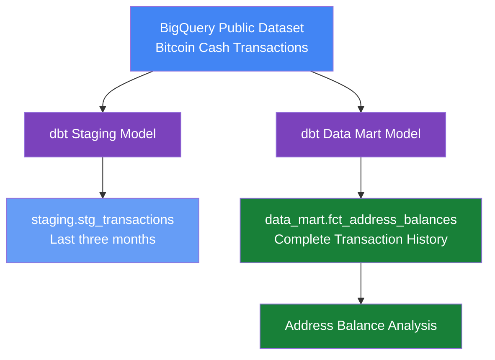

# Bitcoin Cash Project — dbt Pipeline


## 📑 Table of Contents

1. [Project Overview](#1-project-overview)
2. [Data Source](#2-data-source)
3. [Architecture](#3-architecture)
4. [Repository Structure](#4-repository-structure)
5. [Data Transformations](#5-data-transformations)
   - [5.1 Staging Model](#51-staging-model)
   - [5.2 Data Mart Model](#52-data-mart-model)
   - [Important Accounting Assumption](#important-accounting-assumption)
   - [Coinbase Interpretation](#coinbase-interpretation)
6. [Data Quality Tests](#6-data-quality-tests)
7. [Local Setup](#7-local-setup)
8. [Continuous Integration with GitHub Actions](#8-continuous-integration-with-github-actions)
9. [BigQuery Output Tables](#9-bigquery-output-tables)
10. [Related Repository](#10-related-repository)
11. [Conclusion](#11-conclusion)


## 1. Project Overview

This repository contains the data transformation layer of the Bitcoin Cash project.

The objective is to transform public Bitcoin Cash blockchain data into analytical tables using dbt Core and Google BigQuery.

The project implements two main transformations:

- A staging model containing transactions from the last three months.
- A data mart model calculating the balance of Bitcoin Cash addresses while excluding addresses involved in coinbase transactions.

The project also integrates GitHub Actions to automatically execute dbt models and tests whenever a pull request is opened or updated.

---

## 2. Data Source

The project uses the public Bitcoin Cash blockchain dataset hosted on Google BigQuery.

**Source dataset:**

`bigquery-public-data.crypto_bitcoin_cash`

**Source table:**

`transactions`

The dataset contains transaction-level blockchain information, including:

- Transaction hashes.
- Block timestamps.
- Transaction inputs.
- Transaction outputs.
- Input and output values.
- Associated addresses.
- Coinbase transaction indicators.

**Relevant fields include:**

| Field | Description |
|---|---|
| `hash` | Unique transaction identifier. |
| `block_timestamp` | Timestamp of the block containing the transaction. |
| `is_coinbase` | Indicates whether the transaction is a coinbase transaction. |
| `inputs` | Transaction inputs, including spent values and addresses. |
| `outputs` | Transaction outputs, including received values and addresses. |

---

## 3. Architecture





The staging and data mart models use different source scopes:

- Staging processes transactions from the last three months.
- The data mart reads the complete available blockchain history to calculate historical received and spent amounts.

This distinction is necessary because calculating balances using only recent transactions would not represent the actual historical balance.

---

## 4. Repository Structure

```text
bitcoin-cash-dbt/
│
├── .github/
│   └── workflows/
│       └── dbt-run.yml
│
├── macros/
│   └── generate_schema_name.sql
│
├── models/
│   ├── staging/
│   │   └── stg_transactions.sql
│   │
│   └── marts/
│       ├── fct_address_balances.sql
│       └── schema.yml
│
├── tests/
│   ├── unique_transaction_hash.sql
│   └── not_null_transaction_hash.sql
│
├── dbt_project.yml
├── profiles.yml
├── packages.yml
└── README.md
```

---

## 5. Data Transformations

### 5.1 Staging Model

**Model:** `stg_transactions`

**Destination:** `staging.stg_transactions`

The staging model selects transactions from the public Bitcoin Cash dataset where the block timestamp falls within the last three months.

The model is materialized as a BigQuery table partitioned by `block_timestamp_month`.

**Main operations:**

- Read the public transaction table.
- Filter transactions using `CURRENT_TIMESTAMP()`.
- Retain the transaction fields required for downstream analysis.
- Materialize the resulting table in the staging dataset.

### 5.2 Data Mart Model

**Model:** `fct_address_balances`

**Destination:** `data_mart.fct_address_balances`

This model calculates the historical received amount, spent amount and resulting net balance for each address.

Bitcoin Cash follows the UTXO (Unspent Transaction Output) accounting model.

**The balance calculation is:**

```text
Current Balance = Total Received - Total Spent
```

The transformation consists of the following steps:

1. Read the complete transaction history.
2. Extract output addresses and values using `UNNEST()`.
3. Aggregate received amounts by address.
4. Extract input addresses and values using `UNNEST()`.
5. Aggregate spent amounts by address.
6. Identify addresses associated with coinbase transaction outputs.
7. Combine the received and spent address sets.
8. Calculate the final net balance.
9. Exclude addresses identified in coinbase transactions.

**The final table contains:**

| Column | Description |
|---|---|
| `address` | Bitcoin Cash address. |
| `total_received` | Historical amount received. |
| `total_spent` | Historical amount spent. |
| `current_balance` | Net amount received minus spent. |

#### Important Accounting Assumption

The current implementation attributes the full value of an input or output to each address in its associated address array.

For standard single-address transactions, this produces the expected address-level calculation.

However, multisignature outputs or inputs containing multiple addresses require special handling because assigning the full value to every address can cause double counting.

This limitation should be considered when interpreting analytical results.

#### Coinbase Interpretation

The project uses the `is_coinbase` Boolean field to identify mining reward transactions.

Addresses appearing in the outputs of at least one coinbase transaction are excluded from the final data mart.

This interpretation refers to blockchain coinbase transactions, not transactions involving the Coinbase cryptocurrency exchange.

---

## 6. Data Quality Tests

The project includes dbt tests to validate the generated models.

### Staging Tests

- Transaction hashes must not be null.
- Transaction hashes must be unique, verified using a custom SQL test.

### Data Mart Tests

- Address values must not be null.
- Addresses must be unique.
- Current balances must not be null.

Execute all tests using:

```bash
dbt test
```

Custom SQL tests are used for transaction hashes to explicitly quote the hash identifier in BigQuery SQL.

---

## 7. Local Setup

### Prerequisites

- Python.
- dbt Core.
- dbt BigQuery adapter.
- Google Cloud CLI.
- Google Cloud project with billing enabled.
- BigQuery permissions.

### Step 1: Install dbt

```bash
pip install dbt-bigquery
```

### Step 2: Authenticate

```bash
gcloud auth login
gcloud auth application-default login
```

### Step 3: Configure profiles.yml

```yaml
bitcoin_cash_dbt:
  target: dev

  outputs:
    dev:
      type: bigquery
      method: oauth
      project: YOUR-PROJECT-ID
      dataset: staging
      location: US
      threads: 4
      priority: interactive
```

### Step 4: Install dependencies

```bash
dbt deps --profiles-dir .
```

### Step 5: Verify the connection

```bash
dbt debug --profiles-dir .
```

### Step 6: Execute models

```bash
dbt run --profiles-dir .
```

### Step 7: Execute tests

```bash
dbt test --profiles-dir .
```

---

## 8. Continuous Integration with GitHub Actions

The repository uses GitHub Actions to automate dbt execution.

The workflow is located at:

`.github/workflows/dbt-run.yml`

### Trigger Conditions

The workflow executes when:

- A pull request is opened.
- New commits are pushed to an existing pull request.
- A pull request is reopened.

### Workflow Steps

1. Checkout the repository.
2. Set up Python.
3. Install dbt Core and the BigQuery adapter.
4. Authenticate with Google Cloud using Workload Identity Federation.
5. Install dbt dependencies.
6. Execute `dbt run`.
7. Execute `dbt test`.

### Authentication

GitHub Actions uses OpenID Connect (OIDC) to authenticate with Google Cloud.

The following GitHub repository secrets are configured:

| Secret | Description |
|---|---|
| `GCP_WIF_PROVIDER` | Google Cloud Workload Identity Provider resource name. |
| `GCP_SERVICE_ACCOUNT` | dbt service account email. |

No long-lived service account JSON key is stored in GitHub.

The workflow requires:

```yaml
permissions:
  contents: read
  id-token: write
```

The Google Cloud Workload Identity Provider restricts authentication to the authorized GitHub repository.

---

## 9. BigQuery Output Tables

After successful execution, the following tables are materialized:

| Dataset | Table | Description |
|---|---|---|
| `staging` | `stg_transactions` | Transactions from the last three months. |
| `data_mart` | `fct_address_balances` | Historical address balances excluding coinbase-related addresses. |

---

## 10. Related Repository

The Google Cloud infrastructure is managed separately using Terraform:

**bitcoin_cash_terraform**

---

## 11. Conclusion

This project demonstrates an end-to-end Data Engineering pipeline using:

- Terraform for Infrastructure as Code.
- Google Cloud Platform for infrastructure.
- BigQuery for analytical data storage and processing.
- dbt Core for SQL-based transformations and testing.
- GitHub Actions for Continuous Integration.
- Workload Identity Federation for secure authentication.

The resulting architecture provides a reproducible and automated approach to transforming public blockchain data into analytical datasets.

## 👨‍💻 Author

**Astrafy x Yanis**

Bitcoin Cash dbt Pipeline

<p align="center">
Built with ❤️ using dbt, Google Cloud Platform and some hard nights
</p>
